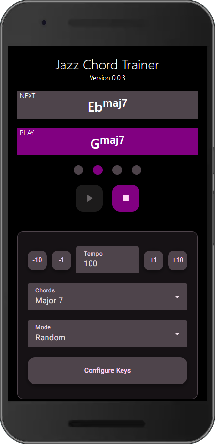

# Jazz Chord Flashcards

The Jazz Chord Trainer is a web application designed to help musicians practice jazz chords in an interactive and structured way. The app displays random chord flashcards (e.g., Cmaj7, G7, Dm7) on the screen, challenging users to play them in time with the specified tempo.

With a built-in tempo control, users can adjust the speed to match their skill level, making it useable for beginners and advanced players alike.

Open Jazz Chord Trainer: https://practice-jazz-chords.com/

## Development server

Run `ng serve` for a dev server. Navigate to `http://localhost:4200/`. The app will automatically reload if you change any of the source files.

## Code scaffolding

Run `ng generate component component-name` to generate a new component. You can also use `ng generate directive|pipe|service|class|guard|interface|enum|module`.

## Build

Run `ng build` to build the project. The build artifacts will be stored in the `dist/` directory.
All routes are prerendered, so each page is complete HTML for search engines and AI crawlers.

## Install as an app (PWA)

- Web app manifest: `src/manifest.webmanifest`, icons in `src/assets/icons/icon-*.png`
- Offline support: Angular service worker, configured in `ngsw-config.json`. Online, every page loads
  its prerendered HTML (`freshness`); offline, the cached client shell (`index.csr.html`) renders any page.
- The service worker runs only in production builds. To try it, serve `dist/jazz-chord-flashcards/browser`
  with a static server (e.g. `npx http-server dist/jazz-chord-flashcards/browser`), not with `ng serve`.
- The Install button: `src/app/services/install.service.ts` (browser prompt, or steps for Safari)

## Search and AI metadata

- Titles, descriptions, canonical URLs, share tags and structured data per page: `src/app/services/seo.service.ts`
  (`PAGE_SEO`), attached to each route as `data: { seo }` in `src/app/app.module.ts`. A new route needs its own entry.
- `src/llms.txt` (summary for AI tools). `llms-full.txt` (the documentation as Markdown) is generated by
  `npm run build` from the prerendered documentation page (`scripts/build-llms-full.mjs`); a plain `ng build`
  leaves it out.
- `src/robots.txt` and `src/sitemap.xml` (update `lastmod` when a page changes)

## Running unit tests

Run `ng test` to execute the unit tests via [Karma](https://karma-runner.github.io).

## Running end-to-end tests

Run `ng e2e` to execute the end-to-end tests via a platform of your choice. To use this command, you need to first add a package that implements end-to-end testing capabilities.

## Further help

To get more help on the Angular CLI use `ng help` or go check out the [Angular CLI Overview and Command Reference](https://angular.io/cli) page.
